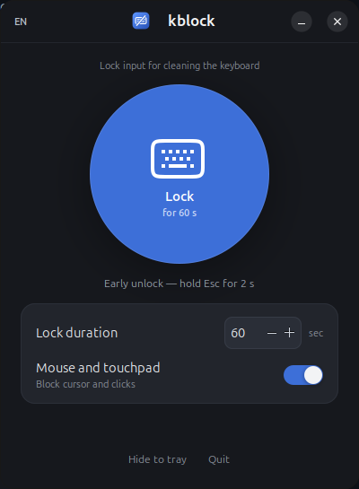
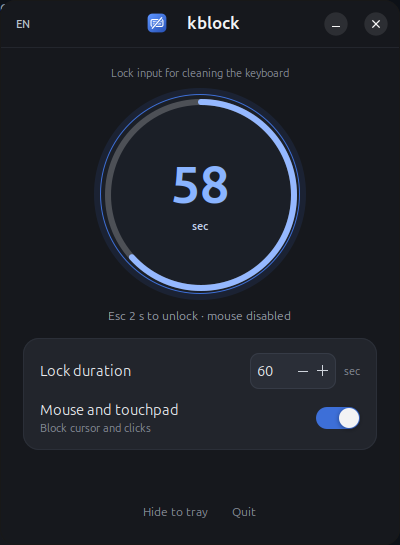

# kblock

[](https://github.com/egoivint/kblock/actions/workflows/ci.yml)

**English** | [Русский](README.ru.md)

A small Linux utility that temporarily locks the keyboard (and optionally the
mouse or touchpad), so you can wipe the device without pressing random keys.
Works on X11 and Wayland.



Hold Esc to unlock early:



## Features

- Locks the keyboard and, optionally, the pointer.
- Timeout or early unlock by holding `Esc` for 2 seconds.
- Round lock button with a hold-progress ring and a dark interface.
- Configurable lock duration and a “Mouse and touchpad” switch.
- Tray icon (StatusNotifierItem) with a menu.
- Six languages: Russian, English, German, Spanish, French, and Chinese.
- Settings are stored in `~/.config/kblock-gui.json`.
- The CLI needs only Python 3 and `libX11` (plus `/dev/input` access on Wayland).

## How it works

On X11, the keyboard is taken with an active `XGrabKeyboard` grab, so key
presses never reach applications.

Wayland does not allow global keyboard grabs. Instead, kblock uses `EVIOCGRAB`
on `/dev/input/event*` devices. This blocks input at the kernel level and works
for native Wayland clients as well. It requires access to the input devices,
which the script in the Wayland section sets up once.

The backend is selected automatically. You can override it with
`--backend x11` or `--backend evdev`.

The grab is released when the process exits, even on `SIGKILL`.

## Requirements

- Linux with X11 or Wayland.
- Python 3 and `libX11`.
- For the GUI: `python3-gi`, `gir1.2-gtk-3.0`.
- For Wayland: access to `/dev/input/event*` (see below).
- For the tray icon on GNOME: the AppIndicator extension (enabled by default
  on Ubuntu).

Ubuntu/Debian:

```bash
sudo apt install python3 python3-gi gir1.2-gtk-3.0 libx11-6
```

## Installation

### From the archive

```bash
tar -xzf kblock-1.0.tar.gz
cd kblock-1.0
./install.sh
```

The script creates symlinks in `~/.local/bin`, adds a desktop entry and an icon,
and copies the helper scripts to `~/.local/share/kblock`. No root is required.

### Debian/Ubuntu

```bash
sudo apt install ./kblock_1.0_all.deb
```

After installation, run `kblock-gui` or use the “kblock” entry in the
application menu.

### From the source tree

```bash
./install.sh
```

## Wayland

Grant the active session user access to input devices once:

```bash
# archive or source tree
sudo ~/.local/share/kblock/setup-input-access.sh
# directly from the source tree
sudo ./setup-input-access.sh
# .deb installation
sudo /usr/share/kblock/setup-input-access.sh
```

The script adds a udev rule with `TAG+="uaccess"` for keyboards, mice, and
touchpads. Access is granted only to the active local session. If the change
does not apply immediately, log out and back in.

Check it with:

```bash
kblock --backend evdev -t 1
```

While the rule is installed, processes of your user can read input events. This
is the price of a global lock on Wayland. If you do not need permanent access,
remove the rule:

```bash
sudo ~/.local/share/kblock/remove-input-access.sh
```

## Usage

GUI:

```bash
kblock-gui              # normal launch
kblock-gui --hidden     # start in the tray
kblock-gui --lang en    # force English
```

CLI:

```bash
kblock                     # auto backend, 30 seconds
kblock -t 90 -p            # 90 seconds, lock the pointer too
kblock --backend x11       # X11 only
kblock --backend evdev     # evdev only (Wayland/TTY)
kblock -t 0                # no timeout
kblock -k F12 --hold 2     # a different unlock key
kblock --help
```

While locked, hold `Esc` for 2 seconds to unlock early. If the pointer is
locked, the mouse does not work — that is expected.

## Development

Project layout:

| File | Purpose |
| --- | --- |
| `kblock` | CLI and both locking backends |
| `kblock-gui` | GTK3 interface and tray icon |
| `install.sh` / `uninstall.sh` | per-user installation and removal |
| `setup-input-access.sh` / `remove-input-access.sh` | udev rule for Wayland |
| `build-release.sh` | builds `.deb` and `.tar.gz` into `dist/` |
| `assets/` | icon and screenshots |

Build the packages:

```bash
./build-release.sh
```

Quick syntax checks:

```bash
python3 -m py_compile kblock kblock-gui
bash -n install.sh uninstall.sh build-release.sh setup-input-access.sh remove-input-access.sh
desktop-file-validate kblock.desktop
```

## Security

- No root is required at runtime, no network connections are made, and commands
  are not executed through a shell.
- The X11 grab is limited to the current X display; the evdev grab affects the
  whole machine while the lock is active.
- Settings are read as JSON and clamped to sane ranges.
- The Wayland udev rule gives the active session user access to input devices.
  Remove it if you do not need that access permanently.

## License

MIT. See [LICENSE](LICENSE).
