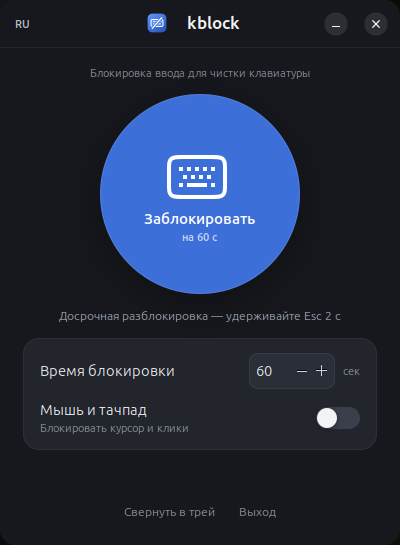
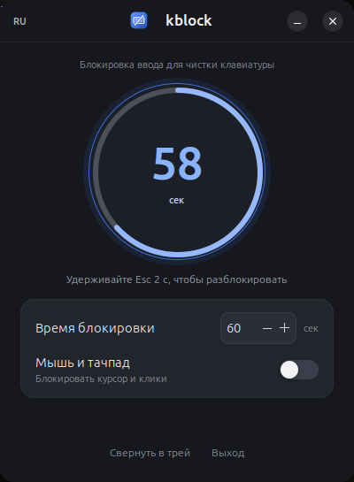

# kblock

[](https://github.com/egoivint/kblock/actions/workflows/ci.yml)

[English](README.md) | **Русский**

Небольшая утилита для Linux: временно блокирует клавиатуру (и при желании
мышь или тачпад), чтобы спокойно протереть устройство и не задеть лишние
клавиши. Работает в X11 и Wayland.



Удержание Esc для досрочной разблокировки:



## Возможности

- Блокировка клавиатуры и, по желанию, указателя.
- Таймаут или досрочная разблокировка удержанием `Esc` (2 секунды).
- Круглая кнопка с кольцом прогресса удержания, тёмная тема.
- Настройка времени блокировки и переключатель «Мышь и тачпад».
- Значок в трее (StatusNotifierItem) с меню.
- Шесть языков: русский, английский, немецкий, испанский, французский, китайский.
- Настройки хранятся в `~/.config/kblock-gui.json`.
- CLI требует Python 3 и `libX11`; в Wayland — ещё доступ к `/dev/input`.

## Как это работает

В X11 клавиатура забирается активным захватом X-сервера (`XGrabKeyboard`),
поэтому нажатия не доходят ни до одного приложения.

В Wayland глобальные захваты запрещены, поэтому используется `EVIOCGRAB` на
устройствах `/dev/input/event*`. Это блокировка на уровне ядра: она действует
и на нативные Wayland-приложения. Для неё нужен доступ к устройствам ввода —
его выдаёт скрипт из раздела «Wayland».

Бэкенд выбирается автоматически. Его можно задать явно: `--backend x11` или
`--backend evdev`.

Захват снимается при завершении процесса, в том числе при `SIGKILL`.

## Требования

- Linux с X11 или Wayland.
- Python 3 и `libX11`.
- Для GUI: `python3-gi`, `gir1.2-gtk-3.0`.
- Для Wayland: доступ к `/dev/input/event*` (см. ниже).
- Для значка в GNOME: расширение AppIndicator. В Ubuntu оно включено по умолчанию.

Ubuntu/Debian:

```bash
sudo apt install python3 python3-gi gir1.2-gtk-3.0 libx11-6
```

## Установка

### Из архива

```bash
tar -xzf kblock-1.0.tar.gz
cd kblock-1.0
./install.sh
```

Скрипт создаёт симлинки в `~/.local/bin`, ярлык в меню приложений, иконку и
копирует вспомогательные скрипты в `~/.local/share/kblock`. Root не нужен.

### Debian/Ubuntu

```bash
sudo apt install ./kblock_1.0_all.deb
```

После установки доступна команда `kblock-gui` и пункт «kblock» в меню.

### Из исходников

```bash
./install.sh
```

## Wayland

Нужно один раз разрешить активному пользователю сессии доступ к устройствам
ввода:

```bash
# установка из архива или из папки проекта
sudo ~/.local/share/kblock/setup-input-access.sh
# либо из распакованного проекта
sudo ./setup-input-access.sh
# для .deb
sudo /usr/share/kblock/setup-input-access.sh
```

Скрипт добавляет правило udev с `TAG+="uaccess"` для клавиатур, мышей и
тачпадов. Доступ выдаётся только активной локальной сессии. Если изменения не
применились сразу, перелогиньтесь.

Проверка:

```bash
kblock --backend evdev -t 1
```

Пока правило установлено, процессы вашего пользователя могут читать события
устройств ввода. Это неизбежная плата за глобальную блокировку в Wayland.
Если постоянный доступ не нужен, правило можно удалить:

```bash
sudo ~/.local/share/kblock/remove-input-access.sh
```

## Использование

GUI:

```bash
kblock-gui              # обычный запуск
kblock-gui --hidden     # сразу в трее
kblock-gui --lang en    # английский интерфейс
```

CLI:

```bash
kblock                     # авто-бэкенд, 30 секунд
kblock -t 90 -p            # 90 секунд, блокировать и указатель
kblock --backend x11       # только X11
kblock --backend evdev     # только evdev (Wayland/TTY)
kblock -t 0                # без таймаута
kblock -k F12 --hold 2     # другая клавиша разблокировки
kblock --help
```

Во время блокировки удерживайте `Esc` 2 секунды, чтобы снять её досрочно.
Если заблокирован указатель, мышь не работает — это ожидаемо.

## Разработка

Структура проекта:

| Файл | Назначение |
| --- | --- |
| `kblock` | CLI и оба бэкенда блокировки |
| `kblock-gui` | GTK3-интерфейс и значок в трее |
| `install.sh` / `uninstall.sh` | установка и удаление для текущего пользователя |
| `setup-input-access.sh` / `remove-input-access.sh` | правило udev для Wayland |
| `build-release.sh` | сборка `.deb` и `.tar.gz` в `dist/` |
| `assets/` | иконка и скриншоты |

Сборка пакетов:

```bash
./build-release.sh
```

Быстрая проверка синтаксиса:

```bash
python3 -m py_compile kblock kblock-gui
bash -n install.sh uninstall.sh build-release.sh setup-input-access.sh remove-input-access.sh
desktop-file-validate kblock.desktop
```

## Безопасность

- Программа не требует root во время работы, не открывает сетевых соединений и
  не запускает команды через shell.
- X11-захват действует в пределах текущего X-дисплея, evdev-захват — на всё
  устройство, пока активна блокировка.
- Настройки читаются как JSON и ограничиваются допустимыми диапазонами.
- Правило udev для Wayland выдаёт доступ к устройствам ввода активному
  пользователю сессии; удаляйте его, если такой доступ не нужен постоянно.

## Лицензия

MIT. См. [LICENSE](LICENSE).
